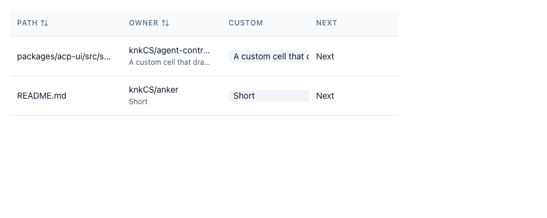
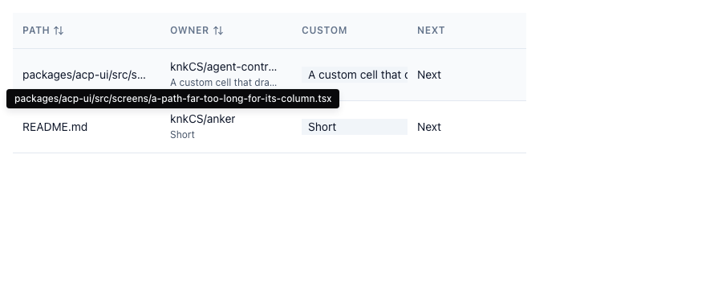

# Show a long value in a DataTable cell

As an author of a UI on anker, I want DataTable to keep every cell's content inside its column, so that no value overlaps its neighbour, whatever cell renders it.

## Context

An author builds a table with `DataTable` from `@knkcs/anker/components` and gives its columns widths (`size`, `minSize`). DataTable clips every cell at its column's edge itself, so content that knows nothing of its column (one of anker's cells, raw text or a custom box) cannot paint over the next column. A text value rendered through `TruncatedTextCell` that does not fit ends in "…", and hovering it opens anker's Tooltip with the whole value.

## Acceptance Criteria

1. In a DataTable whose columns have widths, a cell whose content is wider than its column is cut off at the column's edge and never overlaps the next cell, whether it renders one of anker's cells or custom content.
2. TextCell and TruncatedTextCell show a value wider than their column ending in "…", and hovering it shows the whole value.

## Evidence

Checked at commit `058462e7346cb1a9a3d9cf1d24d5b9f901d3f373`.

- AC1: `src/components/data-table/__tests__/data-table-clipping.browser.test.tsx` passed in Chromium (vitest browser mode, 9 of 9 tests). It covers custom content 400px wide, raw text and a header wider than its 120px column, each measured as visible only inside its cell, with the column kept at its own width. CI's `check` job (`npm run test`) passed on the same commit. In the Storybook story `Components/DataTable › Long Value In Narrow Column`, every cell computed `overflow: hidden`, and the cells sat edge to edge (16–200, 200–364, 364–508, 508–656 px) with nothing drawn across a boundary: 
- AC2: the same browser test file passed its TruncatedTextCell cases: a value wider than its column ends in an ellipsis (`text-overflow: ellipsis`, `white-space: nowrap`), including with `subText`; hovering a shortened value opens the tooltip reading the whole value, also when `maxLength` shortened it; a value that fits opens no tooltip. anker has no separate `TextCell`: `TruncatedTextCell` without `maxLength` is the plain text cell. In the story, hovering the cut path opened a tooltip reading `packages/acp-ui/src/screens/a-path-far-too-long-for-its-column.tsx`: 

## Shaped by

- knkCS/agent-control-plane#887: created
